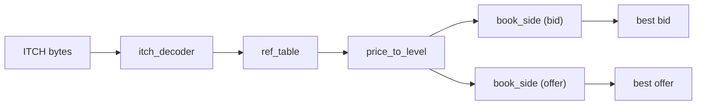

# itch5-feed-handler

A SystemVerilog feed handler and order book for the NASDAQ TotalView-ITCH 5.0 protocol: raw ITCH bytes in, best bid and offer (BBO) out, at a fixed latency of a few clock cycles.

The design is verified in simulation with self-checking testbenches and a bit-exact replay of a full real trading day. It has not been synthesised yet.

## Key results

- **Bit-exact on real market data.** Replaying MSFT on Nasdaq BX (30 Dec 2019), all **91,473** BBO updates match an independent reference model.
- **Fixed 5-cycle latency** from the last byte of a message to the updated BBO, for every message type (6 cycles for the add half of a Replace), at one book operation per clock.
- **No order-table overflow on real data.** The 4-way order table never held more than 3 orders in one set over the day.
- **Consistent book.** Every order added during the day is removed by the day's own messages, and the book is never crossed.

## Architecture



- **`itch_decoder`** — parses the length-prefixed byte stream, filters on stock locate, and turns ITCH messages into book operations. Handles Add (A, F), Executed (E, C), Cancel (X), Delete (D) and Replace (U); other types are skipped.
- **`ref_table`** — stores live orders by reference number (4096 sets × 4 ways), so cancels and executions can find their side and price. Flags `book_degraded` if an order can't be stored.
- **`price_to_level`** — maps a price to one of 1024 levels in a fixed $0.01 window.
- **`book_side`** — one side of the book: quantity per level, best level, and a priority search for the next best when the best level empties.
- **`book_top`** — `ref_table` → `price_to_level` → two `book_side`s.
- **`feed_handler`** — top level: `itch_decoder` → `book_top`.

Main design choices:

- Every message takes the same number of cycles, so updates stay in order. Hazards are handled by forwarding, never by stalling.
- An order that can't be stored never enters the book, so later removals miss harmlessly instead of leaving phantom shares.
- A Replace is split into a Delete and an Add on consecutive cycles. Messages arrive at least 2 cycles apart, so this costs no throughput.

## Verification

Each testbench is self-checking against an independent reference model, and was checked with deliberate design faults to confirm it fails when it should. The testbenches and the Python reference model were written with AI assistance from my specifications, then reviewed, run and mutation-checked by me.

| Testbench | Covers |
|---|---|
| `price_to_level_tb` | every level and window edge, for two window bases |
| `next_best_tb` | next-best search for bid and offer, edge cases and 20,000 random cases |
| `ref_table_tb` | orders sharing sets, all 4 ways, forwarding, overflow, Replace |
| `book_top_tb` | Add / Cancel / Delete, BBO checked every cycle, 20,000 random cycles |
| `itch_decoder_tb` | every message type, skipped types, other stocks, back-to-back messages |
| `feed_handler_tb` | raw bytes to BBO, checked every cycle; measures latency |
| `feed_handler_replay_tb` | full trading day against the Python reference |

## Real-data replay

`scripts/itch_replay_prep.py` reads a NASDAQ historical ITCH file, extracts one stock's messages plus a sample of other stocks' messages, and computes a reference BBO trace. The replay testbench drives the same bytes through the design, and the two traces are compared line by line.

| | |
|---|---|
| File | Nasdaq BX, 30 Dec 2019 |
| Stock | MSFT (locate 5291) |
| Price window | $152.00 – $162.24 |
| Messages replayed | 123,252 |
| Clock cycles | 3,658,165 |
| BBO changes | 91,473, identical to the reference |
| Order-table overflows | 0 |
| Adds outside the window | 29 |

The median MSFT add price was $157.77, against an actual close of $157.76 that day. Shifting the window base by half a tick in the design makes the comparison fail, as expected.

## How to reproduce

Requires Icarus Verilog (12 or later) and Python 3. `book_pkg.sv` must be compiled first.

```bash
mkdir -p build
BOOK="rtl/book_pkg.sv rtl/ref_table.sv rtl/price_to_level.sv rtl/next_best.sv rtl/book_side.sv rtl/book_top.sv"

iverilog -g2012 -o build/fh.out $BOOK rtl/itch_decoder.sv rtl/feed_handler.sv tb/feed_handler_tb.sv
vvp build/fh.out
```

The other testbenches compile the same way with the modules they test. Each ends with `PASS` or `FAIL`.

For the replay, download `Nasdaq BX ITCH/20191230.BX_ITCH_50.gz` from [NASDAQ's historical ITCH data](https://emi.nasdaq.com/ITCH/) into `data/`, then:

```bash
python3 scripts/itch_replay_prep.py data/20191230.BX_ITCH_50.gz MSFT --base 1520000 --out-prefix data/msft

iverilog -g2012 -o build/replay.out $BOOK rtl/itch_decoder.sv rtl/feed_handler.sv tb/feed_handler_replay_tb.sv
vvp build/replay.out +locate=5291 +stream=data/msft_stream.bin +trace=data/msft_sim_bbo.txt

diff data/msft_ref_bbo.txt data/msft_sim_bbo.txt && echo "BBO traces identical"
```

`BASE` in `book_top` must match `--base`. Market data is not included in the repository.

## Limitations

The price window is fixed at 1024 ticks: orders outside it are tracked but don't appear in the BBO, and the window doesn't follow the market. Each instance handles one stock. The decoder takes one byte per clock, while a 10 GbE feed delivers 8, and there is no MoldUDP64 layer yet. The order table can overflow in principle; this is detected and flagged rather than avoided, and the replay covers only one stock on one venue.

All results are from simulation, so latency is given in clock cycles. Synthesis and timing on an FPGA are the next step.